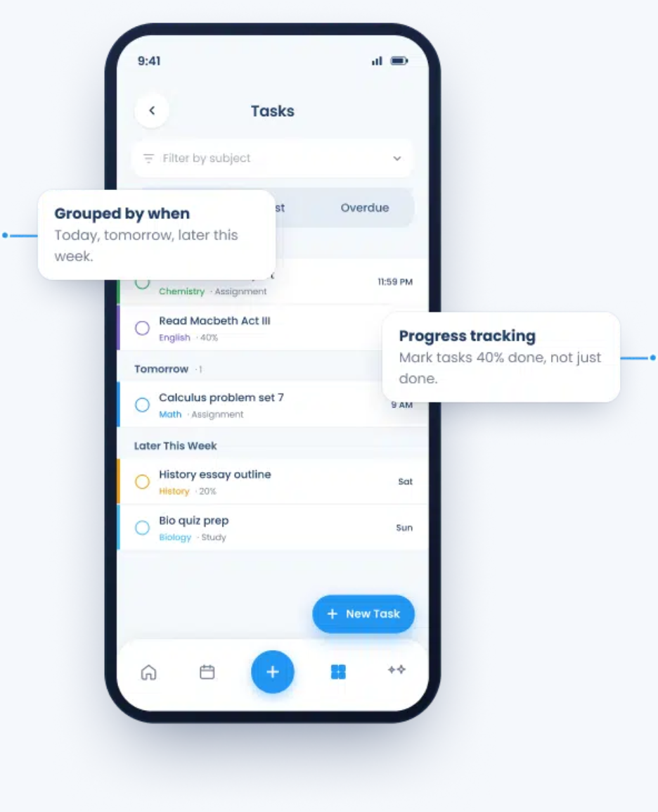
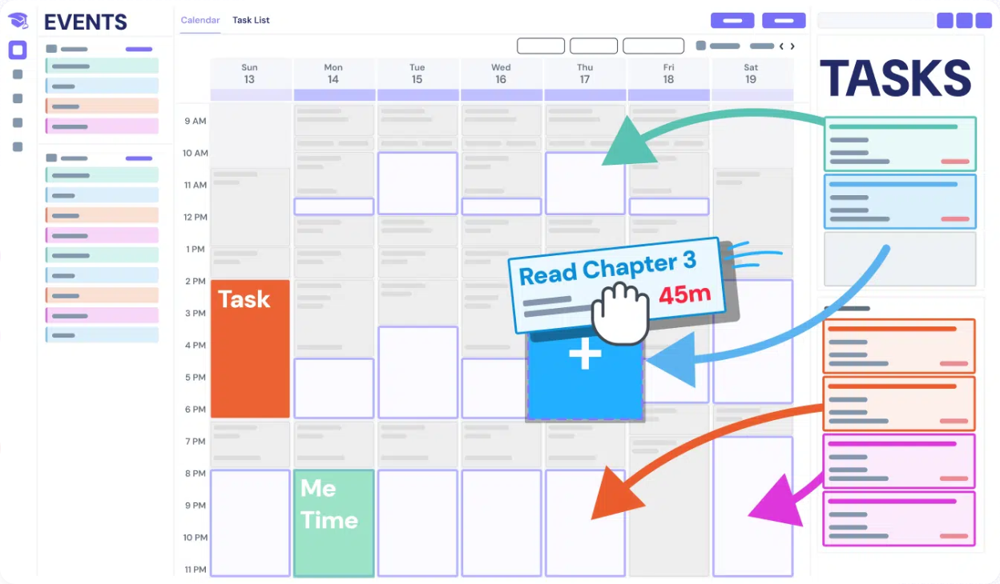
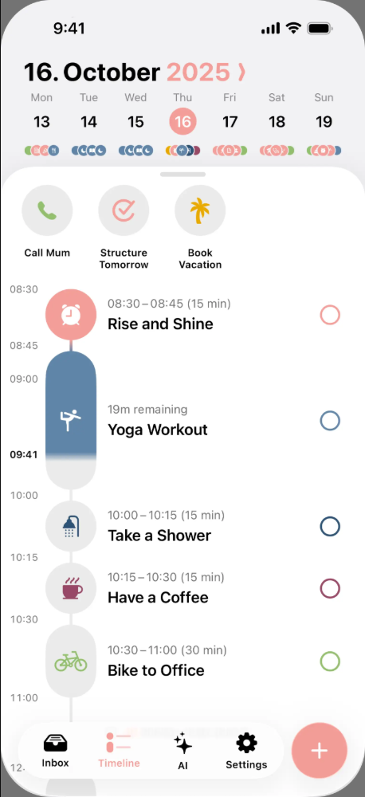
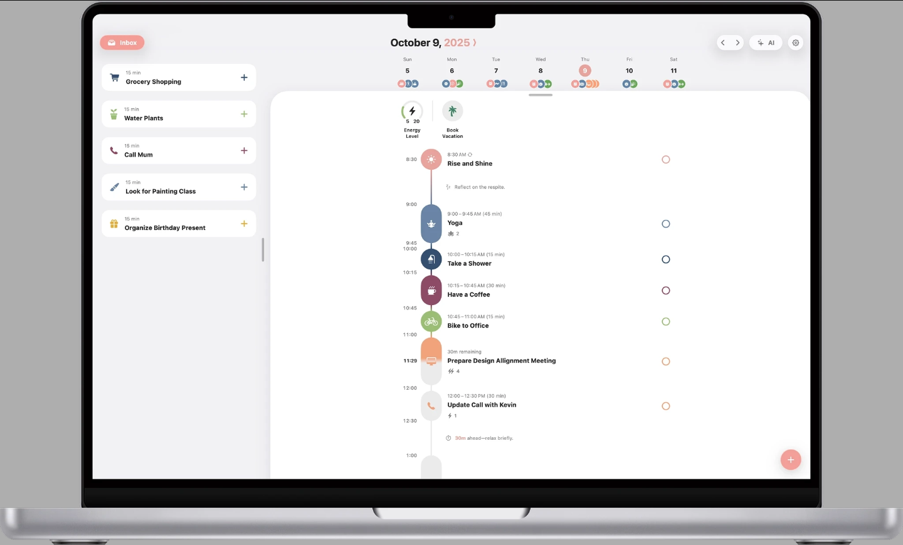

# 竞品与前端参考

复核日期：2026 年 10 月 14 日（Europe/London）。MyStudyLife 与 Shovel 的初始素材采集于 10 月 13 日；Linear 与 Structured 的公开页面及 REA 观测于 10 月 14 日复核。

这份参考用于帮助组员讨论学生学习平台的布局与交互。调查包含官方公开页面、官方展示的产品图片、公开 DOM，以及独立浏览器中的 REA 被动观测。没有登录、注册、购买或访问产品私有代码。**产品图片展示的是官方宣传界面；本次没有实际操作这些产品账户。** 具体 REA Evidence IDs、失败记录和覆盖限制见 [REA 证据记录](REA证据记录.md)。

## 1. 四个参考各解决什么问题

| 参考 | 本次可见的重点 | 对本项目最有用的启发 | 证据边界 |
|---|---|---|---|
| MyStudyLife | 课程表、周历、按日期分组的任务、部分完成状态 | 让学生一直知道当前是哪门课；首页直接呈现今天可以继续的任务 | 官方 App Tour 中的产品宣传图，未登录 App |
| Shovel | Events／周历／Tasks 三栏、任务估时、时间余量示意 | 把学习任务与实际可用时间放在同一视野 | 官网的产品图与流程说明，未验证拖拽或估时算法 |
| Linear | 持续可见的侧栏、列表与详情面板、标题层级、对齐与密度 | 用稳定的工作台承载多门课程和当前任务，减少反复跳页 | 官方设计文章及其中的产品图；REA 观察的是文章网页 |
| Structured | 今日时间线、任务时长、待安排 Inbox、浅色工作区 | 让一个短任务的开始时间、用时和完成状态容易理解 | 官网中的手机／MacBook 宣传图；REA 观察的是营销官网 |

这些产品提供的是规划与工作台参考，**不构成“游戏化能提升学习成绩”或“AI 能判断掌握情况”的证据**。学习效果仍需我们自己的测试。

## 2. MyStudyLife：课程身份和任务进度

官方入口：[App Tour](https://mystudylife.com/tour/)。产品应用链接指向 `web.mystudylife.com`，此次没有进入账户。

产品图里，课程的细色条贯穿课程列表、周历和待办；课程名称与时间同时可见。任务按 Today、Tomorrow、Later This Week 分组，并出现 40%、20% 等部分完成示例。这很适合借鉴到“这一周分几次学习”的体验：离开一项任务也能保留进展。

*图片来源：官方 App Tour 产品宣传图；不是本次登录操作截图。*

可以借鉴：稳定的课程标识、按现实时间分组、明确的继续位置。对课程学习而言，任务完成比例与知识掌握需要分开展示。

素材还包括 [课程表](assets/mystudylife-product-timetable.png)、[周历](assets/mystudylife-product-calendar.png)、[Scout 问答示意](assets/mystudylife-product-scout.png)。Scout 图中的 AI 回答包含可以回到课程计划的任务卡，可用于参考“保存疑问／加入后续练习”的结果呈现；本次没有验证 AI 本身。

## 3. Shovel：任务和可用时间同时可见

官方入口：[Shovel](https://shovelapp.io/)。产品登录域名为 `dig.shovelapp.io`，此次没有登录。

宣传图左边是 Events，中间是周历，右边是 Tasks；任务与课程沿用颜色。图中把 “Read Chapter 3 / 45m” 放到空闲时间的意图很清楚，但箭头和手形属于宣传示意，不能说本次已经测试了拖拽。

*图片来源：Shovel 官网产品示意；未操作实际账户。*

可以借鉴：让“下一步学什么”和“需要多久”相邻；学生可以把一个短关卡安排在课后的空闲时段。不要在缺少个人估时数据时假装能精确预测剩余时间。

另见 [开始时间与任务估时](assets/shovel-product-tasks.png)、[Cushion 余量示意截帧](assets/shovel-product-cushion.png)。截帧只能说明可视化设计，不能解释完整动画或计算公式。两个学生规划产品的完整观察见 [子报告](research-student-planners.md)。

## 4. Linear：稳定工作台和清楚的层级

官方来源：[How we redesigned the Linear UI](https://linear.app/now/how-we-redesigned-the-linear-ui)。文章解释了侧栏、页签、标题和面板的调整，以及通过减少视觉噪声和统一对齐提升层级。图中可直接看到左侧导航、中间条目列表和右侧详情区域。

*来源：官方设计文章中的产品展示图；不是本次进入 Linear 工作区后的截图。*

可以借鉴：左栏固定课程与周次，中间承载当前材料或关卡，辅助信息放到侧面；同类标题、按钮和间距遵守一致规则。深色品牌外观不必直接照搬，长时间阅读课件更应关注文字对比和信息密度。

REA 已实际观察官方文章页面的 DOM、可访问性结构与当前视口，见 [页面证据](evidence/linear-rea-page-20261014.json) 与 [REA 视口截图](assets/linear-rea-viewport.png)。这证明调查过该公开文章，不能证明观察过登录后的 Linear 应用。

技术方面，2026 年 8 月 26 日的 [Linear 官方技术文章](https://linear.app/now/styling-linear-for-the-future-stylex) 明确说明其 React 应用从 styled-components 迁移到 StyleX。这属于**厂商公开说明**，此次没有恢复其内部组件源码。

## 5. Structured：短任务的时间线

官方来源：[Structured](https://structured.app/)。页面介绍把任务合在可视时间线中，并展示手机和电脑上的规划界面。

*两图均为官网已链接的公开产品宣传图片，在独立浏览器中单独显示后截图。不是登录后的实际操作，也不是原生 App 源码分析。原图地址及截图方法见 [素材来源记录](evidence/structured-image-source.json)。*

手机图把时间、时长、标题、完成圆圈排列在同一条时间轴上；正在进行的任务显示剩余时间。电脑图另有左侧 Inbox，为尚未安排的任务留位置。白色工作区、浅灰背景和柔和的任务颜色，使任务内容成为视觉主体。

可以借鉴：关卡卡片显示约需用时和继续位置；“待安排”和“今日学习”分开；完成状态显眼但不打断阅读。

素材校正：旧文件 `structured-product-reference.png` 实际是官网咖啡店视频封面。它不能用于解释产品时间线，因此本报告没有将它作为产品界面展示。首次在官网内截图 MacBook 图片还遇到滚动动画造成空白，已改为单独显示该公开原图，并逐张目视检查。

REA 观测到了 Structured 官网的 `_next/static/chunks/` 脚本、样式资源和图片路径，支持“官网存在 Next.js 资源特征”的判断；不能据此推出原生 App 或 `web.structured.app` 的完整实现。

## 6. 营销站与产品应用的技术必须分开

| 对象 | 实际依据 | 可说到什么程度 | 不能推出什么 |
|---|---|---|---|
| MyStudyLife 官网 | `wp-includes`、Elementor 页面声明与资源路径 | 公开营销页含 WordPress／Elementor 信号 | 不能推出学生 App 的框架、状态管理或数据库 |
| Shovel 官网 | Divi body 类及主题脚本、WordPress 资源路径 | 公开营销页含 WordPress／Divi 信号 | 不能推出产品 App 使用 Divi，不能恢复 Cushion 算法 |
| Linear 官方文章页 | 公开 DOM 中 `static.linear.app/web/_next/` 引用 | 文章网页存在 Next.js 资源特征 | REA 默认源域过滤遗漏 CDN，不能称已采集完整脚本 |
| Linear 产品 | 2026 官方技术文章的 React／StyleX 说明 | 可引用厂商说明 | 本次未恢复专有组件、状态管理和后端 |
| Structured 官网 | REA 页面 Evidence 中同源 `_next` 脚本和资源 | 官网存在 Next.js 资源特征 | 不能外推手机 App 或产品账户的技术栈 |

闭源产品在没有授权源码或相关安装包的情况下，无法从这些营销页恢复完整真实源码。本项目可以自行实现经过参考的布局与交互；报告不会把公开界面观察称为完整产品反编译。

## 7. 建议落实到我们的 Demo

1. **常驻课程上下文。** 侧栏保留学科、课程、周次；主区标题一直显示当前课程。颜色提供辅助辨识，课程名仍是主要标识。
2. **首页直接给出继续入口。** 显示上次停止的位置、下一段约需用时和今日可完成的小步骤，降低开始复习的操作成本。
3. **把材料、问答和任务连接起来。** 一条课堂疑问关联课件页码；保存后在对应课程的后续学习中可找到。界面明确区分“已记录”和“已生成关卡”。
4. **工作台结构稳定，学习主区可变化。** 阅读、课堂问答、任务列表使用一致的导航和标题，情境关卡在主区展开。
5. **进度信息可靠。** 学习任务可部分完成、暂停续学；完成次数、剩余时间和掌握证据各自呈现，不能用装饰性数字冒充学习判断。
6. **先检验核心体验。** 请组员完成“找课件→记疑问→暂停任务→重新继续”四步，观察是否迷路，再决定是否需要复杂日历或更多装饰。

以上是设计建议。界面参考可以帮助可用性，是否提高兴趣、理解或持续使用需要单独评估。

